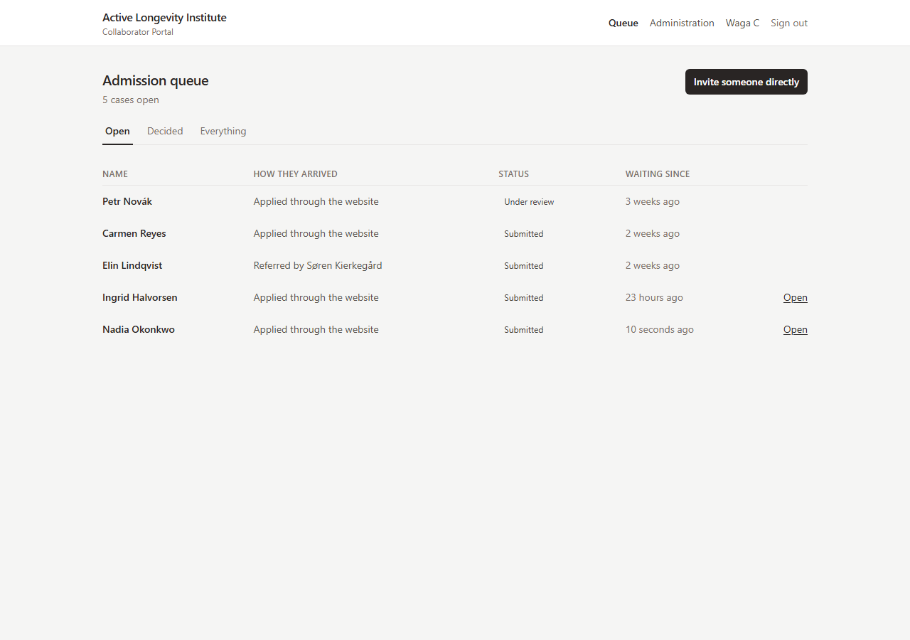
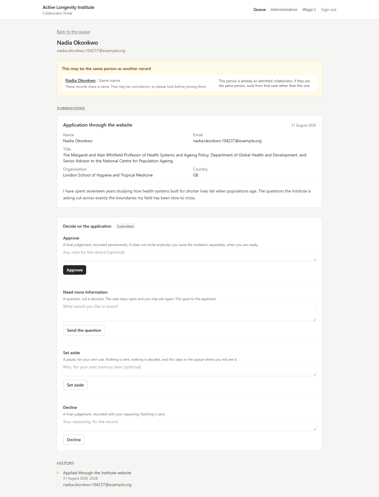
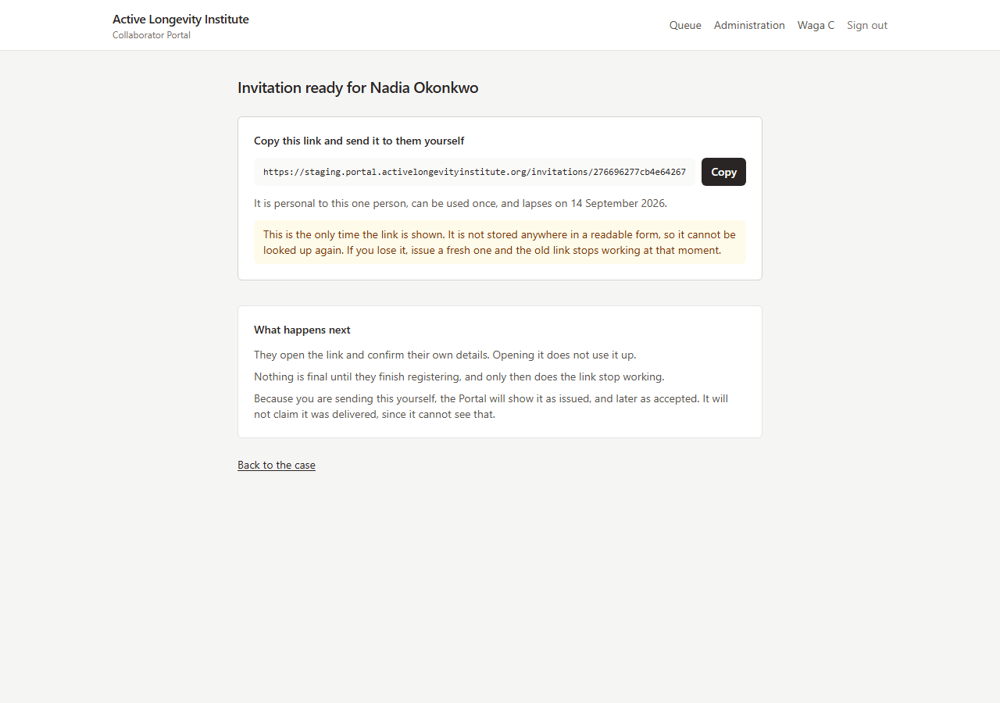
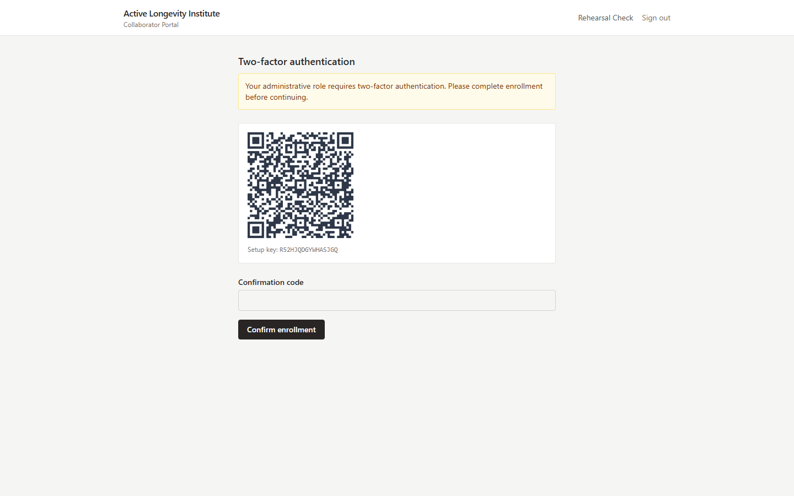
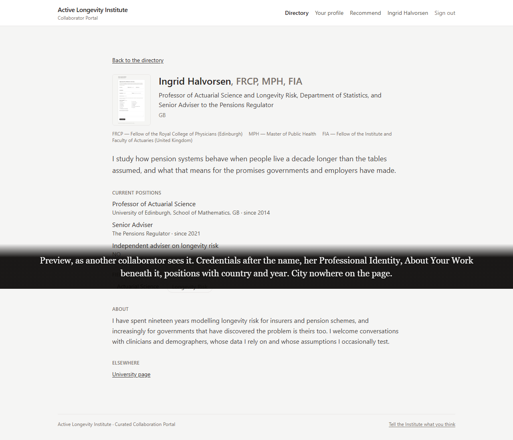
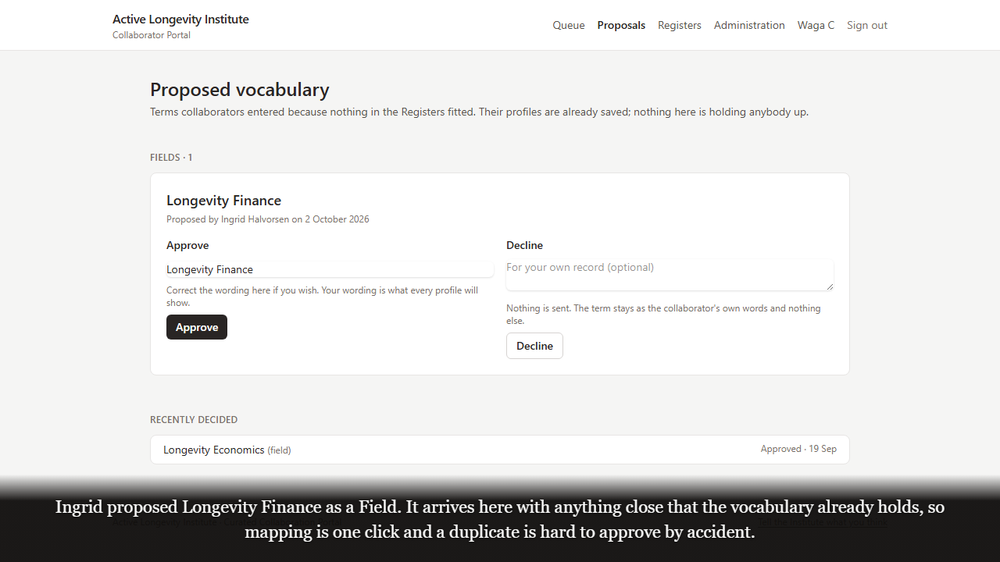

# Invitation-only collaborator portal for a research institute

A private professional community platform for the Active Longevity Institute in Chicago. The
Institute admits people by judgement rather than sign-up, so the Portal is the instrument of that
curation: applications and referrals come in, administrators review each case, invitations go out
as single-use links, and admitted collaborators build a profile and find each other in a directory
organised around the Institute's own vocabulary of Fields and Specialties. It runs in production on
the Institute's own servers at `portal.activelongevityinstitute.org`, with a separate staging
environment.

I designed, built, deployed and documented it end to end across three milestones: the domain model
and architecture package, identity and two-factor authentication, the admission workflow, profiles
and the directory, the controlled-vocabulary engine, the email and audit infrastructure, the
DigitalOcean environments, the CI and deployment pipelines, and the backup and runbook
documentation. Each milestone was delivered with a written report, screenshots and a recorded
walkthrough from the live system.



## What it does

**For the Institute (administrators)**
- An admission queue of every open case, whether it arrived by application, by referral or by
  direct invitation, with the full history of each case kept forever
- Four review actions on a case: approve and offer an invitation, decline, ask the candidate a
  question, or set the case aside
- Invitations as hashed single-use links, shown once, re-sendable with token rotation, revocable,
  and expiring on schedule; a referrer is told when the person they recommended has been invited
- A Proposals queue where terms collaborators typed in because nothing fitted arrive with their
  near matches, so a duplicate is hard to approve by accident
- A Registers screen to add, rename, reorder and retire Fields, Specialties and aliases without a
  developer; renaming updates every profile at once and retiring never deletes
- Collaboration interests and feedback from every page, each recorded with the page it was sent
  from, visible to the Institute only
- Mandatory two-factor authentication before any administrative page, and a plain-English
  "who can see what" table generated from the code that enforces it

**For collaborators**
- Registration from an invitation link, with consent captured in the same transaction that creates
  the collaborator record
- A profile built in sittings: professional identity, a short "about your work", positions (up to
  three, each with organisation, department, country and start year), up to five labelled links,
  a cropped portrait photograph, and up to three credentials from a controlled library where the
  meaning beside each entry is searchable as well as the letters
- "Where your work belongs": a search over 67 Fields and 419 Specialties with aliases, so typing the
  word you use finds the controlled term and explains why; a term that does not exist can be
  proposed without blocking the profile
- A directory that lists a profile only once it says enough for someone to recognise the person,
  searchable by name, Field or Specialty, and country, offering only Fields that actually contain
  someone
- Registering an interest in working with another collaborator, once per pair and only where the
  other person has said they are open to approaches

## How admission works

- **Three ways in, one record.** Website applications, referrals from existing collaborators and
  direct invitations all become a candidate case. Provenance is traversable years later, from an
  admitted collaborator back to the original application or referral.
- **Decisions are data.** Approvals, declines, questions and set-asides are rows in the admission
  tables, each attributed and timestamped, never a status flag overwritten in place.
- **Links that survive email scanners.** The registration link is a GET page with a POST
  confirmation, so a corporate link scanner cannot consume a single-use token on the candidate's
  behalf; a lapsed or used link gets a courteous explanation rather than an error.
- **Consent at the door.** Registration atomically creates the user, the collaborator, the role
  assignment and the consent record, or none of them.

## The vocabulary engine

- Fields, Specialties and aliases are stored as data with cross-Field relationships that serve
  search only; selecting a Specialty never silently assigns a Field
- The Institute's Registers are installed on every deployment by a sync command, and a test proves
  that a rename made in the Registers screen survives the next release
- Profiles can carry pending proposals alongside approved terms, so nobody is held up waiting for
  a vocabulary decision
- Credentials live in a 114-entry starter library; the same letters can map to several records
  (three different FRCPs, for example) and the meaning disambiguates

## Security and the institutional record

- Roles and permissions are data, enforced through a data-driven authorization layer with an
  authorization matrix test as the standing regression net; there is no `is_admin` flag anywhere
- TOTP two-factor authentication with recovery codes, mandatory for administrative roles and
  enforced by an enrollment wall; password confirmation before sensitive pages; rate limiting and
  account-enumeration protection on sign-in and reset
- Account suspension takes effect on live sessions immediately; users with history cannot be
  deleted, only suspended, because the audit stream is append-only and the database enforces it
- Every outbound email is logged with per-message delivery status updated by Postmark webhooks
- A visibility architecture with four audiences, enforced in one place: a collaborator may always
  show less than the Institute permits and never more; city and region are collected and never
  published, and a test proves it
- Secrets live in the Institute's vault and GitHub repository secrets; no credential is in the
  repository

## Stack

| Layer | Choice |
|---|---|
| Application | PHP 8.3, Laravel 12, Laravel Fortify |
| Data | PostgreSQL 16 (required; 31 migrations, additive after deployment) |
| Views | Blade, server-rendered; Vite 7 with Tailwind CSS 4 for assets |
| Two-factor | TOTP with recovery codes (`bacon/bacon-qr-code` for enrollment) |
| Email | Postmark through Symfony Mailer, with a delivery log fed by webhooks |
| Files | DigitalOcean Spaces for photographs |
| Monitoring | Sentry SDK (activates when a DSN is configured) |
| Infrastructure | DigitalOcean droplets for staging and production, managed PostgreSQL, TLS with auto-renewal |
| Delivery | GitHub Actions: CI on every change, auto-deploy to staging, tag-based deploy to production |

## Engineering

- **209 automated tests** across admission, identity, expertise, profiles, visibility, the domain
  model and console commands, run against PostgreSQL 16 in CI with Laravel Pint, Larastan and a
  dependency security audit
- **Architecture before code:** eleven numbered design documents (architecture, domain model, ERD,
  repository structure, authentication, authorization, infrastructure, security model, task
  breakdown, Milestone 2 design package, visibility table) and nine Architecture Decision Records
  in `active-longevity-portal/docs/`
- **Operations documentation:** deployment, runbook (restore, rotation, incident response),
  configuration, database and security references, plus an independent nightly database backup
  script and a recorded restore rehearsal
- **Live-system verification:** the Milestone 3 walkthrough was exercised on the real servers
  before delivery, which surfaced and fixed three deployment faults (photo storage discarded on
  release, missing write permission for uploads, a stale directory flag) that no test environment
  would have shown
- **Delivered in milestones** with a written report, screenshots and a subtitled walkthrough video
  each time: Milestone 1 Foundation and Identity, Milestone 2 Admission System, Milestone 3
  Profiles, Directory and Identity (delivered, then reconciled against the Institute's Registers
  v1.0). Milestone 4, production readiness and handover, is the next phase.

## Screenshots

| | |
|---|---|
|  |  |
| A case: possible duplicate flagged, four review actions, full history | An invitation link, shown once and never stored in readable form |
|  |  |
| Two-factor enrollment wall before any administrative page | A profile as another collaborator sees it |
|  | |
| Proposed vocabulary arriving with its near matches | |

The screenshots come from the Milestone 2 and 3 delivery packages in this repository and were
taken on the staging Portal with demonstration accounts and synthetic data; the caption bars on
two of them are the ones written for the client walkthrough video.

## Running it locally

```
cd active-longevity-portal
composer install
cp .env.example .env                 # PostgreSQL 16 connection; MAIL_MAILER=log for local
php artisan key:generate
php artisan migrate --seed           # schema, roles, permissions, vocabulary
npm install && npm run build
php artisan portal:create-admin      # bootstrap an administrator account
composer dev                         # web server, queue worker, log tail and Vite together
composer test
```

Real `.env` files, deployment keys and Postmark tokens were deliberately excluded from this
repository. `active-longevity-portal/docs/DEPLOYMENT.md` and `RUNBOOK.md` cover the servers.

## Repository notes

- `active-longevity-portal/` is the canonical application and carries the project's real commit
  history (23 commits from the Laravel scaffold to the Milestone 3 reconciliation). The top-level
  `app/`, `config/`, `database/`, `artisan` and `composer.json` are an earlier layout kept for
  reference; `active-longevity-portal (moved-dup 1)/` is a duplicate copy.
- `m1-delivery/`, `m2-delivery/`, `m3-delivery/` and `m3-reconciled-delivery/` hold the client
  reports (HTML and PDF), screenshots, walkthrough scripts and video stills for each milestone;
  `m3-proposal/` holds the Milestone 3 scope and the vocabulary design correspondence.
- The PDFs, `.docx` briefs and WhatsApp images at the root are the client's original brief,
  proposal, wish lists and profile element specifications.
