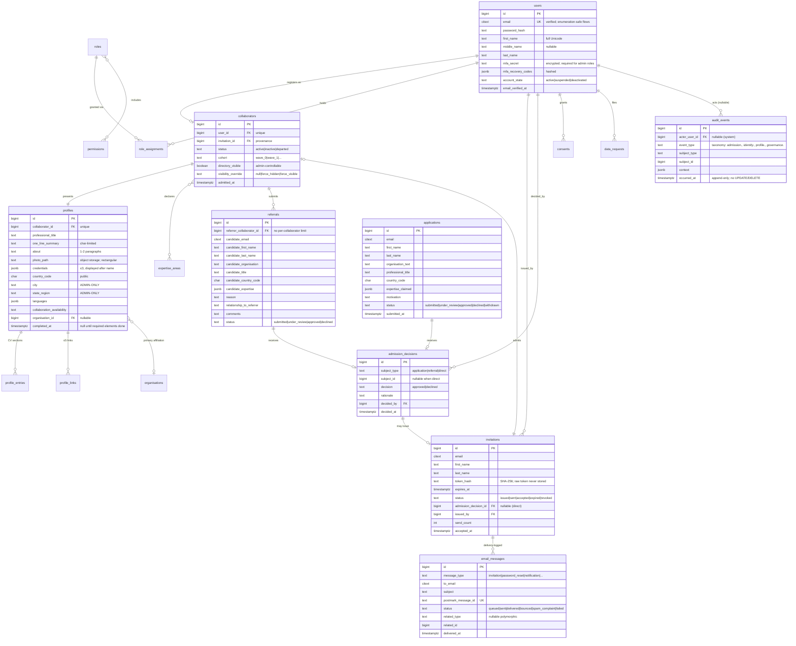

# 03 — Entity-Relationship Diagram & Annotated Schema

**Status:** Draft for internal review · **Milestone:** M1 migrations unless marked *(deferred)*

## 1. ERD

*(Deferred entities — designed, not yet migrated: `collaboration_interests`, `acronyms`,
`acronym_meanings`, `conduct_reports`, `admin_broadcasts`. Shapes recorded in doc 02 §2.)*

## 2. Schema conventions

| Convention | Rule |
|------------|------|
| Encoding / collation | UTF-8, ICU collation — full extended-Latin + diacritics (client standard) |
| Emails | `citext` (case-insensitive) via PostgreSQL extension |
| Time | `timestamptz` everywhere; UTC in the database, localized at display |
| Keys | `bigint` identity PKs; FKs with explicit `ON DELETE` behavior per relationship (mostly `RESTRICT` — institutional history must not cascade away) |
| Soft deletion | Only where the domain justifies it (profiles); pipeline records are never deleted, they change status |
| Status columns | `text` + `CHECK` constraint (readable in psql, enforced in DB, extendable by additive migration) |
| JSONB | For genuinely variable shapes only (CV entry payloads, context, claimed expertise) — never for data we filter/join on institutionally |
| Search | PostgreSQL native: `pg_trgm` on names, tsvector on profile text — no external search service |
| Audit table | Append-only, enforced by revoking `UPDATE`/`DELETE` from the application's DB role |

## 3. Indexing plan (initial)

- `users.email` unique; `invitations.token_hash` unique; `invitations (status, expires_at)` for expiry sweeps
- `applications (status, submitted_at)`, `referrals (status)` — review-queue ordering
- `audit_events (subject_type, subject_id, occurred_at)` — "history of this person" queries
- `email_messages (related_type, related_id)` — per-invitation delivery status
- `collaborators (directory_visible, status)` partial index — directory listing
- Trigram indexes on profile name/title fields — arrives with M3 search surface

## 4. Seed data (M1)

Roles + permissions catalog (doc 06), initial expertise vocabulary (placeholder until Linas
provides his), Founder + developer admin accounts (MFA enforced at first login), synthetic
collaborators/pipeline fixtures for staging demos — clearly fake names, never real people.
